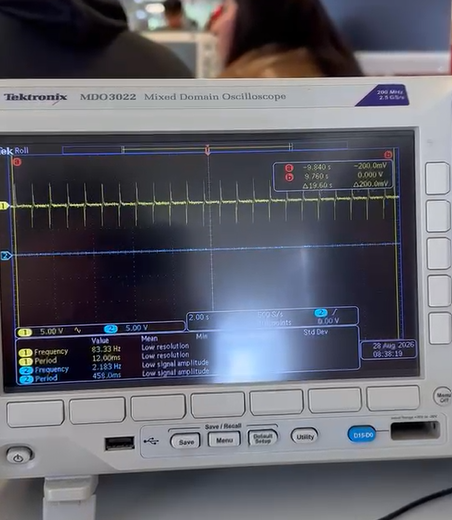
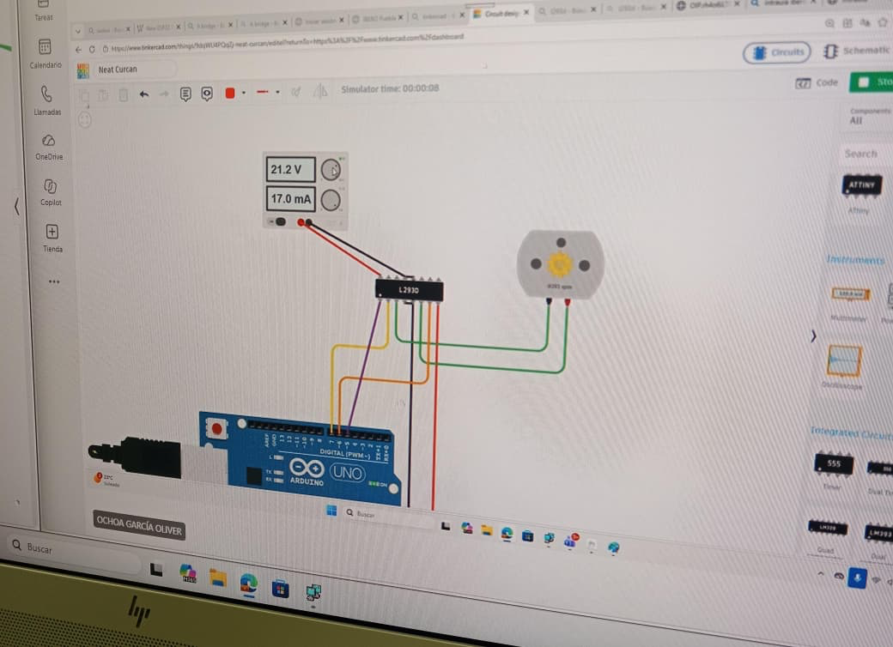
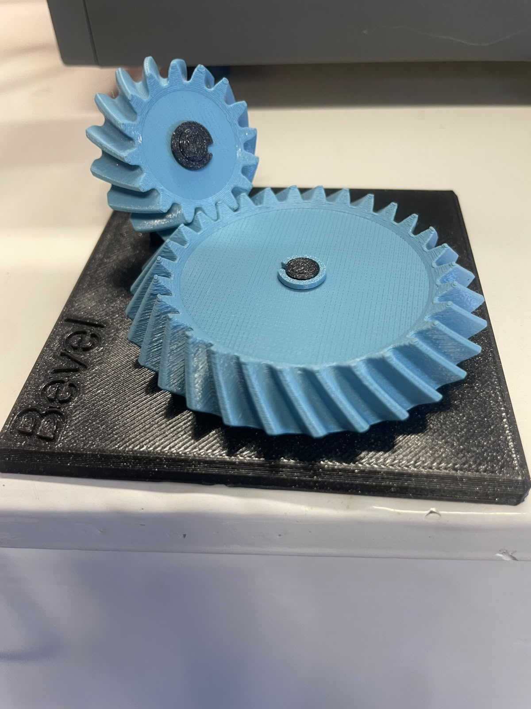
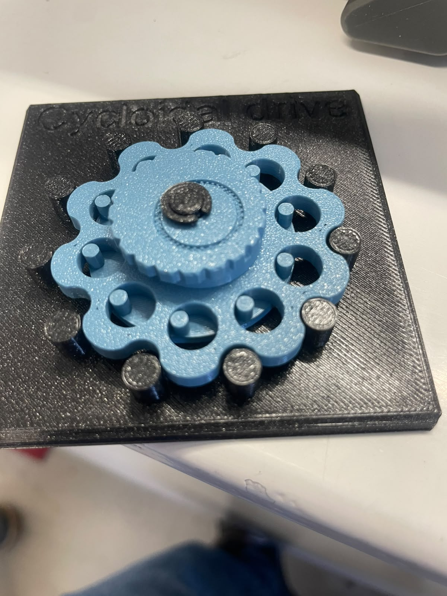
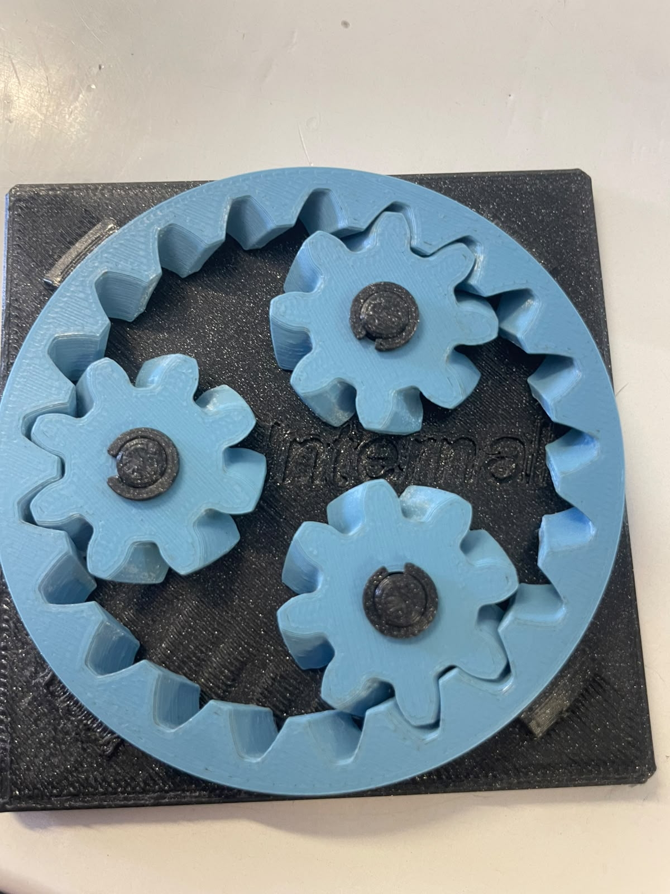
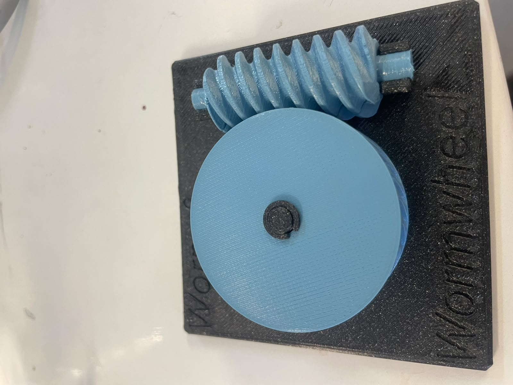

# Portafolio Mecatrónica

Hola, soy Eduardo Gutierrez. Me metí a mecatrónica porque se me hace una carrera muy entretenida debido a todo el trabajo manual que conlleva y la mezcla que tiene entre programación, electrónica, trabajos en madera, corte láser e impresión 3D.


Esta pagian web la cree desde visual estudio con una conexion directa de GitHub, al crear un nuevo repertorio usar ese link y pegarlo aqui, use este grupo de comandos diferentes
``` codigo
```git
git clone
git add .
git commit -m "adicion"
git push
```


## Programa 1
En este programa logramos hacer que un LED parpadee a cierta velocidad aumentando el delay entre acción y acción. 

Que elementos utilise en esta practica?

- Item A
    * Subitem A.1
    * Subitem A.2
    * temporisador 555
    * Capacitor electrolítico de 33 μF
    * Capacitor electrolitico de 10 μF
    * Capacitor cerámico de 10 nF
    * Resistencia 1KΩ
    * Resistencia 15KΩ
    * Resistencia 220 Ω
    * Led azul
    * Cables de puente
    * Protoboard
    ---
En esta practica logre aprender los basicos de la electronica el funcionamiento de microchips pricipalmente t como usar sus entradas y salidas y como varian segun cada uno, aqui se puede ver la protoboard armada y el funcionamiento de la misma 
<iframe width="560" height="315" src="https://www.youtube.com/embed/hHBStf6Kops?si=Bls5IaymzCASYvMG" title="YouTube video player" frameborder="0" allow="accelerometer; autoplay; clipboard-write; encrypted-media; gyroscope; picture-in-picture; web-share" referrerpolicy="strict-origin-when-cross-origin" allowfullscreen></iframe>
Aqui se puede observar como se ve el led parpadeante en un osiloscopio



## Programa 2
En esta práctica empezamos el uso de los Arduinos con un código básico que marca el encendido o apagado mediante el uso de un push button junto con la conexion de el bluetooth mediante el celular
que elementos utilise? 

* ESP32
* Protoboard
* 2 LEDs azules
* 2 resistencias de 220
* Botón pulsador
* Cables de puente
* Cable USB

En la primera parte de esta practica usamos el arduino para proframas un boton simple de encendido y aoagado en el siguinete video podemos ver su funcionamiento

<iframe width="560" height="315" src="https://www.youtube.com/embed/0KOjz-05ZhY?si=6q-aqK4tgEJDStXn" title="YouTube video player" frameborder="0" allow="accelerometer; autoplay; clipboard-write; encrypted-media; gyroscope; picture-in-picture; web-share" referrerpolicy="strict-origin-when-cross-origin" allowfullscreen></iframe>

Durante esta misma práctica, con el uso del Arduino y una aplicación de celular, logramos enlazar los aparatos para permitir que una acción pudiera ser transferida del celular al Arduino:
<iframe width="560" height="315" src="https://www.youtube.com/embed/7Wo4b67l00A?si=cOA1RjMG9BPsNcPy" title="YouTube video player" frameborder="0" allow="accelerometer; autoplay; clipboard-write; encrypted-media; gyroscope; picture-in-picture; web-share" referrerpolicy="strict-origin-when-cross-origin" allowfullscreen></iframe>

Aquí se puede observar el código que fue usado:

``` code
#include <BTAddress.h>
#include <BTAdvertisedDevice.h>
#include <BTScan.h>
#include <BluetoothSerial.h>

BluetoothSerial Mi_tel;

void setup() {
  Mi_tel.begin("Edu");
  Mi_tel.setTimeout(20);
  Serial.begin(9600);
  pinMode(32, OUTPUT);
}

void loop() {
  if(Mi_tel.available()){
    String mensaje = Mi_tel.readStringUntil('\n');
    mensaje.trim();
    if(mensaje == "OFF"){
      digitalWrite(32,1);
    }
    if(mensaje == "ON"){
      digitalWrite(32,0);
    }
  }
}
```
## programa 3
en esta practica aprendimos a usar tinkercad y vimos las bases de el controlamiento de motores basicos y servo motores hicimos dos practicas la primera la mas basica fue hacer que un motor cambiara de direccion  su rotacion, tambien aprendimos un nuevo tipo de microcontrolador el puente h el cua es el responsable de poder invertir las direcciones de los motores.


en el segundo sistema hicimo s que el arduino lograra cambiar la direccion de 3 motores dos normales y un cervo motor, la diferencia entre el servomotor y el normal es que tiene una mayor exactitud y precision a la hora de marcarle pautas 


este fue el codigo que utilisamos

``` codigo
#include <Servo.h>
Servo motor;
void adelante(){
  digitalWrite(6, HIGH);
  digitalWrite(7, LOW);
  digitalWrite(2, HIGH);
  digitalWrite(3, LOW);
}
void atras (){
  digitalWrite(7, HIGH);
  digitalWrite(6, LOW);
  digitalWrite(3, HIGH);
  digitalWrite(2, LOW);
}
void der (){
  digitalWrite(6, HIGH);
  digitalWrite(7, LOW);
  digitalWrite(3, HIGH);
  digitalWrite(2, LOW);
}
void izq (){
  digitalWrite(7, HIGH);
  digitalWrite(6, LOW);
  digitalWrite(2, HIGH);
  digitalWrite(3, LOW);
}
void setup()
{
  //SERVO
  motor.attach(9);

  //MOTOR
  pinMode(6, OUTPUT); //OUT1
  pinMode(7,OUTPUT); //OUT2
  pinMode(3, OUTPUT); //OUT1
  pinMode(2,OUTPUT); //OUT2

  digitalWrite(5, HIGH);
  digitalWrite(1, HIGH);
}

void loop(){
  motor.write(0);
  delay(1000);
  motor.write(90);
  delay(1000);
  motor.write(180);
  delay(1000);
  adelante();
  delay(1000);
  atras();
  delay(1000);
  der();
  delay(1000);
  izq();
  delay(1000);
}
```
## Mecanismos
*Engranaje Bevel*
Qué es y cómo funciona: Está formado por dos ruedas dentadas con forma de cono cuyos ejes se cruzan (normalmente a $90^\circ$). Al girar un cono, sus dientes empujan a los del otro, cambiando la dirección del movimiento de rotación hacia un plano perpendicular.

**Aplicación principal**: Redirigir la fuerza del motor hacia las ruedas en el diferencial de un carro.



*Engranaje cicloidal*
Qué es y como funciona: Utiliza un disco con un perfil ondulado (cicloide) que se mueve de forma excéntrica (bamboleándose) dentro de una corona de pines fijos. Mientras el eje central da muchas vueltas, el disco apenas avanza un poco, logrando una reducción de velocidad descomunal y una multiplicación enorme de la fuerza (par).

**Aplicación principal**: Articulaciones de brazos robóticos industriales y mecanismos que exigen máxima precisión sin holgura.


*Engranaje espiral*
Qué es y cómo funciona: Cuenta con una pista o ranura tallada en forma de caracol (espiral) sobre un disco plano. Cuando un piñón o perno se desliza por esta pista, el movimiento circular se transforma en un desplazamiento radial (alejándose o acercándose del centro de forma guiada).

**Aplicación principal**: Mecanismos de posicionamiento, levas y cerraduras mecánicas.


*Engranaje venus*
Qué es y cómo funciona: Consiste en varias aletas o cuchillas dispuestas en círculo conectadas a un anillo de control giratorio. Al mover el anillo, todas las aletas pivotan simultáneamente y de forma simétrica, abriendo o cerrando el espacio central como un diafragma.

**Aplicación principal**: Se usa en el diafragma de cámaras fotográficas para regular el paso de luz, así como en persianas aerodinámicas activas de la parrilla de un carro o compuertas de regulación de fluidos.

*Engranaje intermitente*
Qué es y cómo funciona: Convierte un movimiento de rotación continuo en un movimiento por pasos (con pausas). Un disco de entrada con un pasador hace avanzar una ranura de la rueda de salida una fracción de vuelta, mientras un borde curvo bloquea rígidamente la rueda durante la pausa.

**Aplicación principal**: Utilizado en antiguos proyectores de cine para avanzar la película fotograma a fotograma con precisión, y en líneas de embotellado o mesas giratorias indexadas por pasos.
Engranaje intermitente


*Engranaje interno*
Qué es y cómo funciona: A diferencia de los engranajes comunes, tiene los dientes tallados en la parte interior de un anillo hueco, permitiendo que un piñón más pequeño gire dentro de él. Esto hace que ambos giren en la misma dirección y compartan espacio de forma muy compacta.

**Aplicación principal**: Se emplea en cajas de cambios automáticas (trenes epicicloidales) y reductores compactos para distribuir la fuerza del motor de manera eficiente.

*Engranaje de articulacion universal*
Qué es y cómo funciona: Es una junta articulada compuesta por dos horquillas conectadas por una cruz central en forma de aspa. Su diseño permite transmitir la rotación entre dos ejes que no están alineados o que forman un ángulo entre sí, incluso si ese ángulo cambia en movimiento.

**Aplicación principal**: Se utiliza en la barra de transmisión longitudinal de vehículos 4x4 o de tracción trasera para llevar la fuerza de la caja de cambios hasta el eje trasero a pesar de los movimientos de la suspensión.

*Engranaje gusano*
Qué es y cómo funciona: Combina un tornillo helicoidal con una rueda dentada perpendicular. Cada vuelta completa del tornillo hace avanzar un solo diente, logrando una alta reducción de velocidad, un cambio de eje a $90^\circ$ y un comportamiento autobloqueante (el tornillo mueve a la rueda, pero la rueda jamás puede mover al tornillo).
**Aplicación principal**: Se aplica en los sistemas de elevación de lunas/ventanillas de los carros, limpiaparabrisas, afinadores de guitarra y mecanismos donde la carga no debe retroceder sola.



##


| Estación | ¿Qué transforma? (vel↔par, rot↔trasl, continuo↔intermitente, cambio de eje) | Relación \( i \) estimada (cuenta dientes o vueltas) | ¿Reversible o autobloqueante? | ¿Dónde lo has visto en la vida real? | ¿Dónde serviría en el carro o en un proyecto tuyo? |
| --- | --- | --- | --- | --- | --- |
| A · Diferencial |Distribuye rotación y ajusta Velocidad $\leftrightarrow$ Par |$i \approx 3:1$ a $5:1$ |reversible |caja de cambios |girar ruedas a distintas velocidades en curvas |
| B · Cicloidal |Baja velocidad y aumenta mucho el par. |$i \approx 10:1$ a $50:1$ |reversible | brasos roboticos| robot para levantar peso|
| C · Cardán |Cambia el ángulo/eje de rotación. |$i = 1:1$ |Reversible | Transmisión de camionetas 4x4.| Transmitir fuerza al eje trasero|
| D · Obturador |Movimiento Continuo $\leftrightarrow$ Intermitente |$i = 1:1$ |Reversible |Cámara de fotos | Compuerta o corte de paso.|
| E1 · (espiral) |Rotación a desplazamiento radial |$i \approx 1:1$ a $3:1$. |Reversible |Cerraduras y mecanismos de guía |Palanca o ajuste mecánico. |
| E2 · (intermitente) |Giro Continuo $\leftrightarrow$ Avance por pasos (pausado). |$i = 6:1$.    | Autobloqueante (en la pausa).|Proyectores de cine y embotelladoras |Mesa giratoria por pasos. |